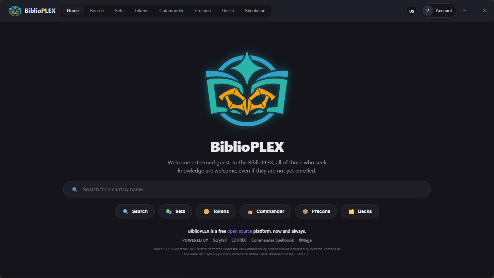
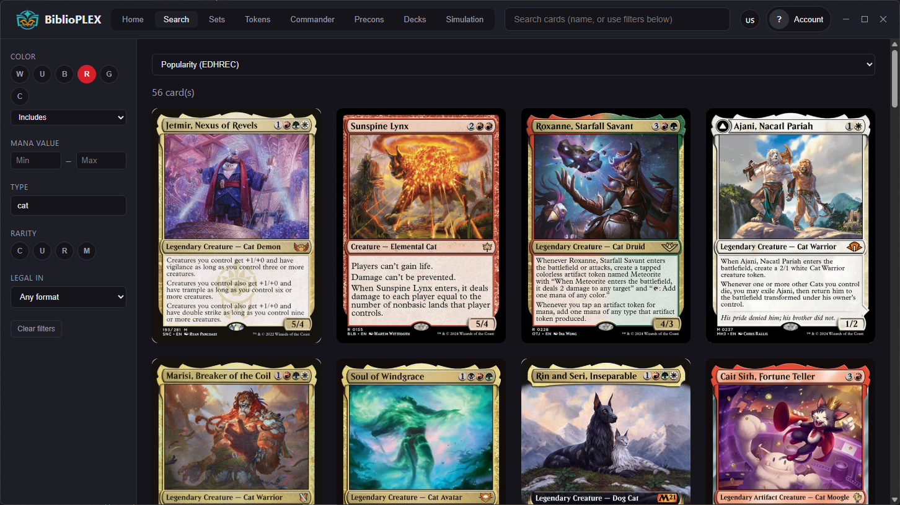
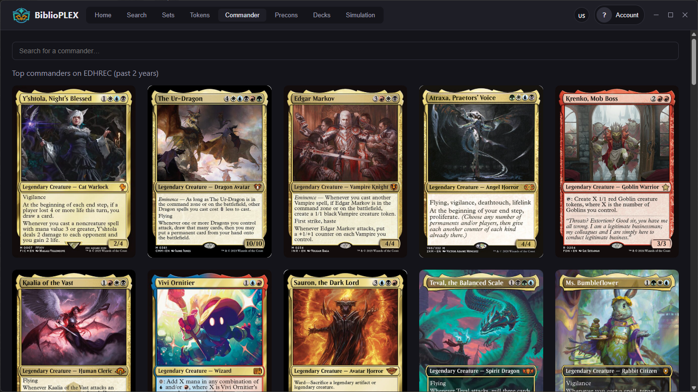
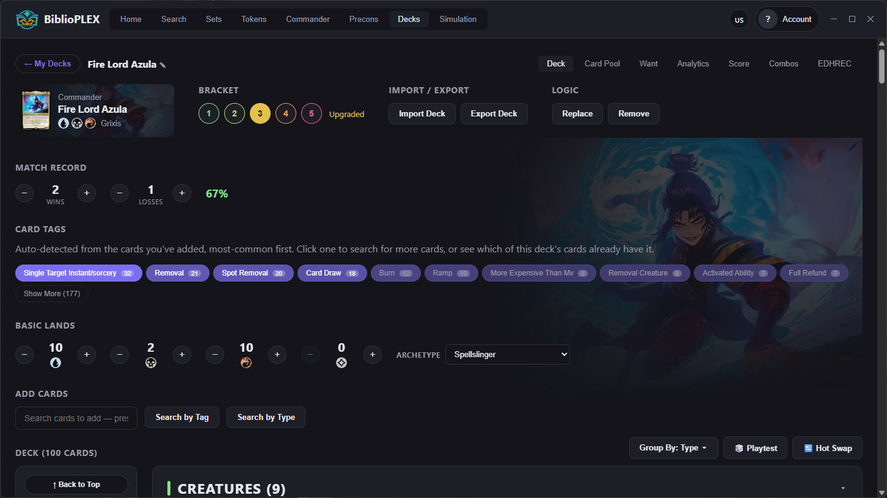
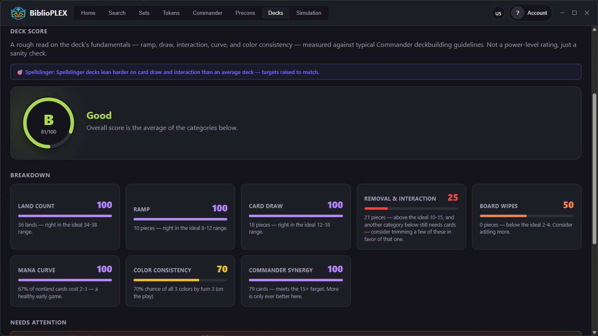
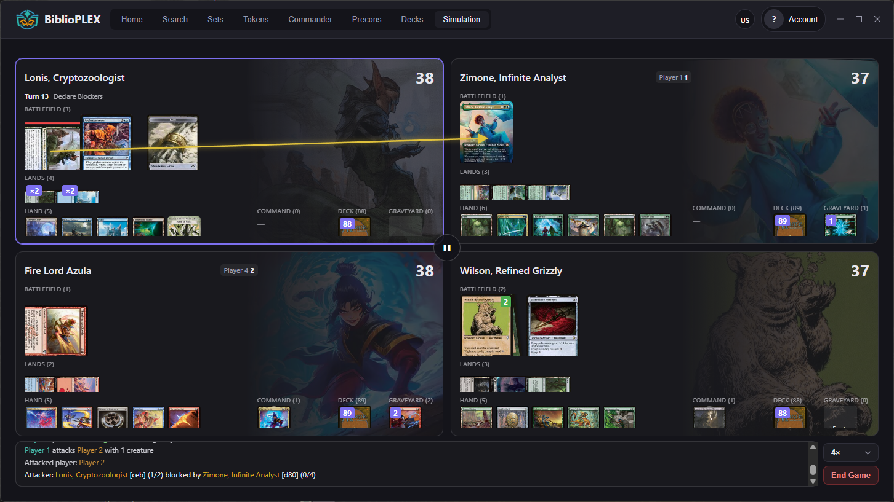

# BiblioPLEX

A Windows desktop app (Electron + React + TypeScript) for Magic: The Gathering — card search,
Commander/EDH deck building, EDHREC-driven recommendations, a real rules-accurate solo playtest
engine, and more. Physical TCG only.

## Features

- **Search** the full Scryfall card database with structured filters (color, type, mana value,
  rarity, legality) or free-text queries, plus click-to-search on any type/subtype from a card's
  own inspect view.
- **Deck building** for Commander/EDH: singleton enforcement, Partner/Background second-commander
  support, Commander Bracket tracking, drag-to-reorder, multiple grouping modes (type, color,
  cost, subtype, set), a Card Pool and Want list, and Hot Swap for quick substitutions.
- **Tag Search** across the whole card pool, backed by both Scryfall Tagger's community tags and
  a local fallback tagger, plus per-deck user tag overrides.
- **Deck Score & Analytics**: ramp/draw/removal/wipe/curve targets (with archetype-aware
  adjustments), a mana-curve and color-consistency breakdown, and Commander Spellbook combo
  detection.
- **EDHREC integration**: commander recommendations, the site's real Top Commanders ranking, and
  a full precon library resolved to exact historical decklists.
- **Playtest**: a lightweight goldfish sandbox (shuffle, draw, freeform battlefield, tap/untap),
  and a full rules-accurate bot-vs-bot simulator built on the [XMage](https://github.com/magefree/mage)
  engine.

## Screenshots

| | |
|---|---|
|  |  |
|  |  |
|  |  |

## Stack

`electron-vite` (`src/main` for the Electron/Node main process, `src/preload` for the context
bridge, `src/renderer/src` for the React 19 + TypeScript UI), plus `java-bridge/` — a small Java
sidecar that embeds XMage to run real Magic games headlessly.

## Getting started

```bash
npm install
npm run dev
```

Other useful scripts:

```bash
npm run typecheck   # tsc --noEmit across both the main and renderer tsconfigs
npm run build       # electron-vite build
npm run build:win   # package a portable Windows build
```

The Playtest simulator needs a JDK on your `PATH` to build/run `java-bridge/` (see that folder's
`pom.xml`), and a portable JRE under `resources/jre-win-x64/` for packaged Windows builds — that
JRE isn't checked into this repo (it's a large third-party binary); provide your own for local
packaging, or skip `build:win`'s JRE bundling if you don't need a fully portable executable.

The Card Tag Index and Combo Index (Tag Search's card pool and the "Combo" tag) build themselves
on first use from Scryfall's bulk data and Commander Spellbook's API — see the in-app "Build Card
Tag Index" / "Build Combo Index" buttons in Tag Search. `resources/card-tag-index/` isn't checked
into this repo either (the built index is 150MB+); `resources/tagger-data/` (the Scryfall Tagger
scrape) is included since it's small and takes hours to rebuild from scratch.

## Data sources & attribution

BiblioPLEX pulls card data and images from [Scryfall](https://scryfall.com), commander
recommendations and precon decklists from [EDHREC](https://edhrec.com), combo data from
[Commander Spellbook](https://commanderspellbook.com), and its rules engine from
[XMage](https://github.com/magefree/mage). None of these projects endorse or are affiliated with
BiblioPLEX.

BiblioPLEX is unofficial Fan Content permitted under the Fan Content Policy. Not
approved/endorsed by Wizards. Portions of the materials used are property of Wizards of the
Coast. ©Wizards of the Coast LLC.

## License

BiblioPLEX's own code is [MIT licensed](LICENSE). `java-bridge/` compiles directly against
XMage, which is [GPL-3.0](https://github.com/magefree/mage/blob/master/LICENSE) — that
sub-component is bound by GPL-3.0's terms regardless of the MIT license on the rest of this
repo; see `java-bridge/pom.xml` for its exact XMage dependency versions.
